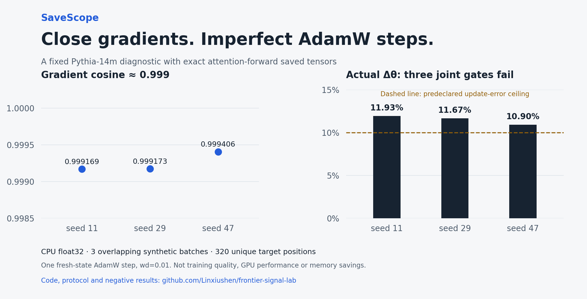

# SaveScope

**A 0.999 gradient cosine can still leave an inaccurate optimizer update. Inspect both.**

SaveScope audits saved-tensor compression against exact backward: full gradients,
actual first-step AdamW deltas, explicit module scopes, and per-parameter errors.
It includes a reusable Python API, an executable CPU example, and an offline
interactive evidence viewer.

[Open the interactive case](https://linxiushen.github.io/frontier-signal-lab/) ·
[Install & API guide](SAVESCOPE.md) · [贡献反例](CONTRIBUTING.md) ·
[中文研究记录](RESEARCH_LAB.zh.md)

```bash
git clone https://github.com/Linxiushen/frontier-signal-lab.git
cd frontier-signal-lab
python -m pip install .
python -m savescope replay --output replay
```

Open `replay/index.html`. This verifies and displays recorded evidence; **it does
not execute a model**. No ML dependencies, account, GPU or network access are
needed for replay. To execute the tiny CPU example, install Torch + NumPy and
run `python -m savescope demo --output tiny-run`; see the [guide](SAVESCOPE.md).

## A concrete reason to check the update

On a pinned Pythia-14m checkpoint and three fixed, overlapping synthetic batches,
keeping attention-forward saved tensors exact improved gradient cosine to about
**0.999**. Actual float32 AdamW first-step update errors were still **10.9–11.9%**.
All three batches failed the **predeclared 10% update-error ceiling**.



This is a reproducible failure case, not a general claim about compression.
The comparison uses fresh zero moments, weight decay 0.01, exact loss and norm
scopes, 76 parameter tensors, and independent NumPy parameter/moment controls.

| Evidence | Result |
| --- | --- |
| [Full-gradient scope diagnostic](results/activation-attention-gradient/report.md) | All three attention-scope gradient gates passed |
| [Actual AdamW update diagnostic](results/activation-update/report.md) | All three joint update gates failed; controls passed |
| [Separate accumulated-state follow-up](results/activation-state-update/report.md) | Four dense warmup steps; matched-state gates pass, fresh-state controls at warmed weights fail |
| [New-data short-history follow-up](research/2026-10-16-short-history-update.md) | All 12 common-anchor gates pass; separate dense/INT8 histories still show large moment drift |
| [Natural-text training cost and final evaluation](research/2026-10-16-training-cost-and-final-evaluation.md) | All six joint screens fail; slower CPU training, all endpoints regress; parent RSS observer invalid |
| [Windows process observer](results/process-observer/report.md) | Five controlled engineering cases pass; training integration still pending |
| [CPU Torch workload integration](results/workload-observer/report.md) | Six controlled engineering cases pass, including native descendants; pretrained training harness remains unvalidated |
| [Pinned pretrained training integration](results/training-observer/report.md) | Failed at preimport: unexpected descendants; zero model loads or updates, all recorded processes cleaned up |
| [Windows child-image census](results/child-image-census/report.md) | Runtime identity controls complete; frozen audit rejects two self-hash assumptions, training remains forbidden |
| [Dual self-path / OS-image census](results/dual-identity-census/report.md) | Two bounded identity/cleanup controls and frozen audits pass; extras remain unapproved and training remains forbidden |
| [Narrow process-role policy](results/role-policy-probe/report.md) | Three controls pass; exact console roles admitted, same-image Python/cmd extras rejected; actual training integration remains unvalidated |
| [Timestamped pretrained integration v2](results/training-observer-v2/report.md) | Failed after three package imports on denied `socket.bind`; zero model loads/updates; both precise failure controls pass |
| [Actual pretrained integration v3](results/training-observer-v3/report.md) | Five controlled cases pass; three pinned model loads and six dense updates; scientific cost/quality unchanged |
| [Observer duty during fixed dense training](results/observer-duty/report.md) | Four loads/64 updates; producer passes, frozen audit rejects four end-barrier ordering checks; no accepted overhead result |
| [Observer duty with exact worker acknowledgment](results/observer-duty-v2/report.md) | Separately frozen four loads/64 updates pass receipt audits; two descriptive ON/OFF ratios 1.040/1.062, previous rejection retained |
| [Earlier matched-token training](results/activation-training/report.md) | Slower CPU execution, higher process peak, both synthetic holdouts regressed |

The tool reports numerical disagreement without hiding failed scientific gates.
It does not demonstrate better model quality, GPU performance, peak-memory
reduction or a new architecture. Logical saved payload bytes are not allocator
peak memory. CPU float32, eager, first-order execution only in v0.

The [accumulated-state research probe](research/2026-10-16-accumulated-state-update.md)
checks optimizer-history sensitivity at three fixed warmed points. It does not
extend v0.1's fresh-state API or establish compression training quality.

The [new short-history probe](research/2026-10-16-short-history-update.md) audits
steps 4 and 8 of separate dense/INT8 trajectories on new fixed data. All 12
local gates pass (1.335–1.564% update error), while one paired point has moment
relative L2 differences of 0.861 and 1.955. Local fidelity does not establish
trajectory equivalence. [Verify the public receipts without Torch](fixtures/activation-history/README.md)
or re-execute the frozen model probe for numerical reproduction.

The [new complete-cost case](results/activation-cost/report.md) compares 64-step
and approximately 60-second training, then scores every fixed endpoint once.
INT8 took 5.4–12.2% longer at equal training volume; all 12 final NLLs exceeded
the initial model's. A separate [validity review](results/activation-cost/measurement-validity.json)
also found that parent RSS sampling did not establish the training interpreter's
memory; a separate launch-path check found a distinct launcher PID. Native worker self-peaks are retained
separately. The unmodified negative receipts and a standard-library auditor are
public; passing that consistency audit does not validate the failed observer.

The separate [Windows process observer](fixtures/process-observer/README.md) now
passes five controlled identity, memory and descendant-cleanup cases. It is
standard-library tooling with a portable receipt auditor. It has not been
integrated into training and does not repair historical RSS measurements.

The [separate Torch integration](fixtures/workload-observer/README.md) now passes
six fixed engineering cases, including one CPU backward/SGD update per workload,
native descendant identity, busy timeout/private threshold and precise failure
controls. Its portable auditor launches no processes. Pretrained training,
observer overhead and historical scientific measurements retain separate gates.

The next [frozen pretrained integration](fixtures/training-observer/README.md)
failed before model import: each authenticated case found two unexpected
descendants. Only the deliberate exit37 control passed. Actual model loads and
updates were zero; all recorded handles exited and each Job became empty.
The failed receipt and rejection audit are preserved. Complete child image
identity is the next gate before another separately declared training attempt.

The separate [child-image census](fixtures/child-image-census/README.md) now records OS images for bounded observed descendants and rejects a helper with the same Python executable. It grants no training permission and cannot identify unrecorded historical children.

A new [dual-identity version](fixtures/dual-identity-census/README.md) independently binds self executable and retained OS image roles to frozen file/path hashes. Both controlled cases pass, while the earlier frozen rejection remains unchanged. This establishes bounded engineering identity controls only.

The [separate narrow role policy](fixtures/role-policy-probe/README.md) now passes three fixed no-ML controls: healthy admission plus rejection of an extra Python interpreter and native command using the same frozen executable files. Eight held inventories retain nineteen exited identities and three empty Jobs; the independent portable auditor passes 1053 checks. This environment-specific role contract clears one engineering prerequisite. Actual pretrained training, continuous child coverage, historical RSS and scientific cost/quality remain separate gates.

The [v2 actual integration](fixtures/training-observer-v2/README.md) then ran once
with timestamped controller/worker controls. Three workload arms completed
Torch/Transformers import but stopped on a denied Python `socket.bind` event;
the saved worker PID and seven threads satisfy their checks. Model loads and
updates remain zero. Both exact failure controls passed; all 21 retained
identities exited and all five Jobs were empty. The frozen success auditor
still rejects ten checks. A separate post-outcome checker preserves this
failure. [Static diagnosis and next gate](research/2026-10-17-pretrained-observer-and-teardown-bounds.md)
distinguish a possible IPv6 probe from an established runtime cause.

The separate [v3 actual integration](fixtures/training-observer-v3/README.md)
now passes all five controlled cases: three pinned local model loads and six
dense updates, exact import-phase probe provenance, stage memory, busy/cap and
cleanup. Held sampler observation cost is retained. This clears a bounded
engineering prerequisite; earlier scientific failures and invalid historical
RSS remain unchanged. [Measured result and limits](results/training-observer-v3/report.md).

## Bring one counterexample

Try an operator or exact-save scope on your model. Share one sensitive parameter
and a minimal reproducer with dtype, seed and loss boundary. See
[CONTRIBUTING.md](CONTRIBUTING.md) and the [API contract](SAVESCOPE.md#use-your-own-model).

This repository also contains the original public research radar and recovery
experiments. Their [history](RESEARCH_LAB.zh.md), [source ledger](research/sources.json),
[hypotheses](research/hypotheses.json), and [operating protocol](OPERATIONS.md)
remain available. Employment announcements are discovery leads, not evidence
of anyone's private research plans or endorsement of this project.

MIT for original tooling and examples. No model weights are bundled.
