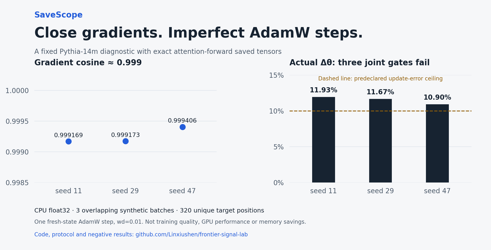

# SaveScope

**A 0.999 gradient cosine can still leave an inaccurate optimizer update. Inspect both.**

SaveScope audits saved-tensor compression against exact backward: full gradients,
actual AdamW deltas, explicit module scopes, and per-parameter errors.
It includes a reusable Python API, an executable CPU example, and an offline
interactive evidence viewer.

The API can also compare one update from your **existing AdamW moments and
per-parameter step counters**: pass `optimizer=optimizer` to `audit`. Each policy
uses private clones of the same captured state. See the
[supported state contract](SAVESCOPE.md#use-your-own-model).

[Open the interactive case](https://linxiushen.github.io/frontier-signal-lab/) ·
[Install & API guide](SAVESCOPE.md) · [贡献反例](CONTRIBUTING.md) ·
[中文研究记录](RESEARCH_LAB.zh.md) ·
[规模化工程研究路线](research/engineering-roadmap.md)

```bash
git clone https://github.com/Linxiushen/frontier-signal-lab.git
cd frontier-signal-lab
python -m pip install .
python -m savescope replay --output replay
```

Open `replay/index.html`. This verifies and displays recorded evidence; **it does
not execute a model**. No ML dependencies, account, GPU or network access are
needed for replay. To execute the tiny CPU example, install Torch + NumPy and
run `python -m savescope demo --output tiny-run`; see the [guide](SAVESCOPE.md).

## A concrete reason to check the update

On a pinned Pythia-14m checkpoint and three fixed, overlapping synthetic batches,
keeping attention-forward saved tensors exact improved gradient cosine to about
**0.999**. Actual float32 AdamW first-step update errors were still **10.9–11.9%**.
All three batches failed the **predeclared 10% update-error ceiling**.



This is a reproducible failure case, not a general claim about compression.
The comparison uses fresh zero moments, weight decay 0.01, exact loss and norm
scopes, 76 parameter tensors, and independent NumPy parameter/moment controls.

| Evidence | Result |
| --- | --- |
| [Native training cost v4 / negative saved scores](results/native-training-cost-scopes-v4/report.md) | 12loops/2,130updates and12endpoint scores generated; frozen evaluator acceptance FAILED. Separate saved comparisons0/6, all NLLs above initial; v5 cleanup fix has pure tests only |
| [Native training cost v3 / preservation caller failure](results/native-training-cost-scandir-v3/report.md) | Dense seed503 completed64updates; paired INT8 loaded but failed before a complete loop. Ten cases/all evaluation unrun; no paired cost/quality result. Separate v4 group-flattening fix has pure regressions only |
| [Pending authority and cancellation recovery](results/pi-generation-cancellation/report.md) | One frozen two-Session native suite:12host admissions,8Faux generation/tool chains,6unique local effects,two process reopens; revoked/cancelled host-only work never submits. Native error/collision, real HTTP/model and production unverified |
| [Disk custody handoff to Gateway](research/2026-11-01-repository-disk-gateway-custody.md) | Landed explicit Move source path binds a verified worktree before disk retirement/cleanup; disk mode remains unselectable. Source/test design only |
| [Explicit repository-disk snapshots](research/2026-11-01-explicit-repository-disk-snapshots.md) | Landed capture/export prerequisite with immutable retry aliases and source checks; disk mode remains inactive. Source/test design only, no local recovery result |
| [Live rollout adoption source review](research/2026-11-01-live-rollout-adoption.md) | Open Verifiers proposal; retained VM/job identity, explicit duplicated in-flight model call and replay-cache limits. Source/test design only; no local VM run or recovery upgrade |
| [Pending authority/cancellation preparation](research/2026-11-01-pending-authority-cancellation.md) | Same native service's next complete workload is prepared; 19 Python/7 Node checks pass. No new native run or freeze: observed free disk below unchanged 1 GiB gate; recovery targets remain unverified |
| [Pi native admission reconciliation](results/pi-generation-admission/report.md) | One frozen two-Session suite:20native submissions,16local effects,count1,8recovered reservations,two reopens across reservation/submit/ID-link gaps. Official local Faux; pending authority/cancel-crash/production unverified |
| [Pi generation/tool identity and recovery v2](results/pi-generation-v2/report.md) | One frozen native two-Session slice passes:14generation/14tool,10local effects,count1,two reopens,exact dynamic/stable API bindings. Official Faux fixture; admission commit gaps/real HTTP/model/production unverified |
| [Pi actual generation/tool attempt](results/pi-generation/report.md) | Frozen FAILED: auditor assumed fixed Faux API identity;3processes/2reopens,50 raw files preserved. Post-outcome observations do not rescue acceptance; zero model loads |
| [Pi native paced two-Session caller](results/pi-durable-paced/report.md) | One frozen refusal/retry pair: two native Sessions per arm, bounded pending4, six processes/four reopens; 0/36 versus12/36 load effects under deliberately held capacity. Local custom tasks only; no causal or full-Agent/model claim |
| [Pi native bounded-burst load](results/pi-durable-load/report.md) | One frozen4arm suite passes: capacity2/4, direct/buffered sinks,12process starts/8reopens; exact outcomes and scoped cost endpoints, no full-agent or general performance claim |
| [Pi durable service v3 / accepted native recovery slice](results/pi-durable-service-v3/report.md) | One frozen native suite passes: three processes/two restarts, bounded admission, current-authority refusal, cancellation and four local effects count1; fixed single-host custom tasks only, no provider or performance upgrade |
| [Pi durable service v2 / rejected final database audit](results/pi-durable-service-v2/report.md) | Three native stages/two process restarts ran; frozen acceptance failed on our JSON-encoded kind lookup. Six terminal tasks/four local effects independently observed after outcome; failure retained, no retry or acceptance upgrade |
| [Pi durable service v1 / failed native open](results/pi-durable-service-v1/report.md) | One frozen process exits before admission on our context-export error; zero tasks/effects/restarts. All intended H2 service checks remain unexecuted; exact bytes and independent database-copy audit retained, no retry |
| [Same-caller import stack observation](results/native-training-import-observation/report.md) | One15s stack points to Transformers import-structure construction;20s startup still fails. 0 model loads/updates, five retained exits/empty Job. Location captured, root cause and cost/quality unproven; no retry |
| [Native complete training cost v2 / import deadline](results/native-training-cost-v2/report.md) | Corrected CLI launches first native case; fixed20s import deadline stops after Transformers-start. 0 model loads/updates/evaluations, 11 remaining cases unrun; five retained exits/empty Job. No cost/quality result or retry; accepted ledger gate stays closed |
| [Native complete training cost / failed launch](results/native-training-cost/report.md) | Frozen CLI fails on relative-output comparison before any native/model launch; 0/12 cases, no cost/quality result or retry. Separate guarded entrypoint regression passes; actual-caller ledger gate stays closed |
| [Actual training caller / ledger v3](results/training-ledger-v3/report.md) | Same actual producer accepted after separately frozen full-directory controls; two CPU loads/16updates, partial-write refusal,10exits/twoemptyJobs; complete-cost/quality remains open |
| [Actual training caller / ledger v2](results/training-ledger-v2/report.md) | Two CPU loads/16updates complete with ledger and injected pretrain I/O refusal; frozen auditor rejects omitted progress files. Post-outcome preservation is separate; 10 exits/two empty Jobs |
| [Actual training caller / ledger v1](results/training-ledger/report.md) | Frozen import-stage timeout before model load; one native sample/two rows, five retained exits/empty Job; acceptance remains rejected, no retry |
| [Native observer / ledger integration attempt](results/observed-job/report.md) | Failed before sampling: Job count2 versus frozen1; extra process unidentified, worker exit/empty Job verified; two fault cases unrun |
| [Native observer / ledger v2](results/observed-job-v2/report.md) | Four native producer cases complete, 32 samples/10 retained exits/four empty Jobs; frozen audit rejects partial-tail and helper-console assumptions. Post-outcome preservation is separate; no acceptance or training upgrade |
| [Native observer / ledger v3](results/observed-job-v3/report.md) | Same producer, corrected pre-frozen auditor: four cases/32 samples/10 exits/four empty Jobs accepted; stdlib prerequisite closed, return to actual pretrained caller; zero model loads/updates |
| [v0.2 caller AdamW state integration](results/savescope-optimizer-state/report.md) | Reusable existing-moments API; one tiny CPU fixture passes 16 controls, with dense native hash parity and a fresh-reset negative control |
| [Thread-safe trace ledger prerequisite](results/trace-ledger/report.md) | One frozen seven-arm thread fixture passes sequence/cap/fault controls; native stdlib integration now accepted in v3, actual pretrained caller remains next |
| [Full-gradient scope diagnostic](results/activation-attention-gradient/report.md) | All three attention-scope gradient gates passed |
| [Actual AdamW update diagnostic](results/activation-update/report.md) | All three joint update gates failed; controls passed |
| [Separate accumulated-state follow-up](results/activation-state-update/report.md) | Four dense warmup steps; matched-state gates pass, fresh-state controls at warmed weights fail |
| [New-data short-history follow-up](research/2026-10-16-short-history-update.md) | All 12 common-anchor gates pass; separate dense/INT8 histories still show large moment drift |
| [Natural-text training cost and final evaluation](research/2026-10-16-training-cost-and-final-evaluation.md) | All six joint screens fail; slower CPU training, all endpoints regress; parent RSS observer invalid |
| [Windows process observer](results/process-observer/report.md) | Five controlled engineering cases pass; training integration still pending |
| [CPU Torch workload integration](results/workload-observer/report.md) | Six controlled engineering cases pass, including native descendants; pretrained training harness remains unvalidated |
| [Pinned pretrained training integration](results/training-observer/report.md) | Failed at preimport: unexpected descendants; zero model loads or updates, all recorded processes cleaned up |
| [Windows child-image census](results/child-image-census/report.md) | Runtime identity controls complete; frozen audit rejects two self-hash assumptions, training remains forbidden |
| [Dual self-path / OS-image census](results/dual-identity-census/report.md) | Two bounded identity/cleanup controls and frozen audits pass; extras remain unapproved and training remains forbidden |
| [Narrow process-role policy](results/role-policy-probe/report.md) | Three controls pass; exact console roles admitted, same-image Python/cmd extras rejected; actual training integration remains unvalidated |
| [Timestamped pretrained integration v2](results/training-observer-v2/report.md) | Failed after three package imports on denied `socket.bind`; zero model loads/updates; both precise failure controls pass |
| [Actual pretrained integration v3](results/training-observer-v3/report.md) | Five controlled cases pass; three pinned model loads and six dense updates; scientific cost/quality unchanged |
| [Observer duty during fixed dense training](results/observer-duty/report.md) | Four loads/64 updates; producer passes, frozen audit rejects four end-barrier ordering checks; no accepted overhead result |
| [Observer duty with exact worker acknowledgment](results/observer-duty-v2/report.md) | Separately frozen four loads/64 updates pass receipt audits; two descriptive ON/OFF ratios 1.040/1.062, previous rejection retained |
| [Codec allocation diagnostic: preimport failure](results/codec-allocation/report.md) | First case rejected by our budget/count contract error; zero model loads, updates or allocation traces; frozen failure and post-outcome regressions retained |
| [Codec allocation v2: lifetime and callback cost](results/codec-allocation-v2/report.md) | Eight cases pass; selected forward backing decreases by 2,693,632 B, INT8 pack temporary requests reach 524,800 B; descriptive CPU timing costs, no training-quality or process-peak claim |
| [Stage-labelled training current memory](results/training-phase-memory/report.md) | One load/two updates; clearing 56,270,848 logical gradient bytes leaves native private bytes 147,456 higher; both zero_grad intervals unsampled |
| [Memory queries versus global Toolhelp snapshots](results/observer-query-treatment/report.md) | Four loads/64 updates pass; two descriptive T/M ratios 1.069/1.016, memory-only samples about 50 Hz; whole-process readings are sampled lower bounds |
| [Earlier matched-token training](results/activation-training/report.md) | Slower CPU execution, higher process peak, both synthetic holdouts regressed |

The tool reports numerical disagreement without hiding failed scientific gates.
It does not demonstrate better model quality, GPU performance, peak-memory
reduction or a new architecture. Logical saved payload bytes are not allocator
peak memory. CPU float32, eager, first-order execution only in v0.

The [accumulated-state research probe](research/2026-10-16-accumulated-state-update.md)
checks optimizer-history sensitivity at three fixed warmed points. It does not
extend v0.1's fresh-state API or establish compression training quality.

The [new short-history probe](research/2026-10-16-short-history-update.md) audits
steps 4 and 8 of separate dense/INT8 trajectories on new fixed data. All 12
local gates pass (1.335–1.564% update error), while one paired point has moment
relative L2 differences of 0.861 and 1.955. Local fidelity does not establish
trajectory equivalence. [Verify the public receipts without Torch](fixtures/activation-history/README.md)
or re-execute the frozen model probe for numerical reproduction.

The [new complete-cost case](results/activation-cost/report.md) compares 64-step
and approximately 60-second training, then scores every fixed endpoint once.
INT8 took 5.4–12.2% longer at equal training volume; all 12 final NLLs exceeded
the initial model's. A separate [validity review](results/activation-cost/measurement-validity.json)
also found that parent RSS sampling did not establish the training interpreter's
memory; a separate launch-path check found a distinct launcher PID. Native worker self-peaks are retained
separately. The unmodified negative receipts and a standard-library auditor are
public; passing that consistency audit does not validate the failed observer.

The separate [Windows process observer](fixtures/process-observer/README.md) now
passes five controlled identity, memory and descendant-cleanup cases. It is
standard-library tooling with a portable receipt auditor. It has not been
integrated into training and does not repair historical RSS measurements.

The [separate Torch integration](fixtures/workload-observer/README.md) now passes
six fixed engineering cases, including one CPU backward/SGD update per workload,
native descendant identity, busy timeout/private threshold and precise failure
controls. Its portable auditor launches no processes. Pretrained training,
observer overhead and historical scientific measurements retain separate gates.

The next [frozen pretrained integration](fixtures/training-observer/README.md)
failed before model import: each authenticated case found two unexpected
descendants. Only the deliberate exit37 control passed. Actual model loads and
updates were zero; all recorded handles exited and each Job became empty.
The failed receipt and rejection audit are preserved. Complete child image
identity is the next gate before another separately declared training attempt.

The separate [child-image census](fixtures/child-image-census/README.md) now records OS images for bounded observed descendants and rejects a helper with the same Python executable. It grants no training permission and cannot identify unrecorded historical children.

A new [dual-identity version](fixtures/dual-identity-census/README.md) independently binds self executable and retained OS image roles to frozen file/path hashes. Both controlled cases pass, while the earlier frozen rejection remains unchanged. This establishes bounded engineering identity controls only.

The [separate narrow role policy](fixtures/role-policy-probe/README.md) now passes three fixed no-ML controls: healthy admission plus rejection of an extra Python interpreter and native command using the same frozen executable files. Eight held inventories retain nineteen exited identities and three empty Jobs; the independent portable auditor passes 1053 checks. This environment-specific role contract clears one engineering prerequisite. Actual pretrained training, continuous child coverage, historical RSS and scientific cost/quality remain separate gates.

The [v2 actual integration](fixtures/training-observer-v2/README.md) then ran once
with timestamped controller/worker controls. Three workload arms completed
Torch/Transformers import but stopped on a denied Python `socket.bind` event;
the saved worker PID and seven threads satisfy their checks. Model loads and
updates remain zero. Both exact failure controls passed; all 21 retained
identities exited and all five Jobs were empty. The frozen success auditor
still rejects ten checks. A separate post-outcome checker preserves this
failure. [Static diagnosis and next gate](research/2026-10-17-pretrained-observer-and-teardown-bounds.md)
distinguish a possible IPv6 probe from an established runtime cause.

The separate [v3 actual integration](fixtures/training-observer-v3/README.md)
now passes all five controlled cases: three pinned local model loads and six
dense updates, exact import-phase probe provenance, stage memory, busy/cap and
cleanup. Held sampler observation cost is retained. This clears a bounded
engineering prerequisite; earlier scientific failures and invalid historical
RSS remain unchanged. [Measured result and limits](results/training-observer-v3/report.md).

## Bring one counterexample

Try an operator or exact-save scope on your model. Share one sensitive parameter
and a minimal reproducer with dtype, seed and loss boundary. See
[CONTRIBUTING.md](CONTRIBUTING.md) and the [API contract](SAVESCOPE.md#use-your-own-model).

This repository also contains the original public research radar and recovery
experiments. Their [history](RESEARCH_LAB.zh.md), [source ledger](research/sources.json),
[hypotheses](research/hypotheses.json), and [operating protocol](OPERATIONS.md)
remain available. Employment announcements are discovery leads, not evidence
of anyone's private research plans or endorsement of this project.
The [SQLite snapshot canary](results/sqlite-snapshot-canary/report.md) adds a
stdlib-only recovery check: a copy can pass integrity checks while omitting
committed messages; it preserves raw files and offers an offline receipt audit.

MIT for original tooling and examples. No model weights are bundled.


H2 native busy/error/collision (2026-11-02 11:20Z): one separately frozen two-Session suite passes, 18arrivals/14host reservations/4overload,2nativebusy/2typeerrors/2changed-content IDreuses/4hostquarantines; 10Generation/Tool/official localFaux chains plus2writes,6local effects count1,14host/20native taskterminals, 3PIDs/2forcedkills/reopens and finalactive0. Host quarantine never adopts/automatically aborts foreign native work; fixture cleanup is conversation-wide after exact original identity checks. Suite5.000s, controller44.032s and completeCLI44.328s (including authentication) are separate observations. Finite gate CLOSED; next separately preregister independent durable effects/transport at this native tool boundary, current authority/cancel/idempotency and two reopens, no observer detour. Official deterministic localFaux/single trusted Windows owner; no real model/HTTP/tenant/concurrent-owner/externalexactlyonce/GPU/production or causal performance proof. Old H1negative/invalidRSS/5GiB and H3/H4 unchanged. [Result](results/pi-generation-conflict/report.md).


H2 native scoped HTTP effect (2026-11-02 13:39Z): one separately frozen suite with two native Sessions passes. It records 16 arrivals, 12 host reservations, four overload refusals, 12 GenerationTask/ToolTask chains with official local Faux, eight separately persisted loopback HTTP effects (each count 1), 14 GETs and 14 POSTs. Six reservations recover; 12 host records and 24 native tasks reach terminal states, with final active count 0. Three native processes include two forced kills and reopens; three server processes include two graceful reopens. Lookup recovers committed receipts after cancellation. Native numeric IDs repeat across Sessions, so remote authority binds a stable service scope. While scheduling is paused, public task-abort calls mark the exact original pairs before conversation-wide abort can resume scheduling. The suite takes 7.172 s, the controller 35.828 s and the complete CLI 36.234 s; these are distinct scopes. All 95 raw files (2,072,017 bytes) and nine stopped SQL copies are retained. This finite gate is CLOSED. Next work must separately preregister current-authority/cancellation with concurrent callers in the same runtime, or integration into an actual runner. Evidence covers free loopback HTTP and deterministic Faux under one trusted owner. It does not establish real-model quality, tenant authentication, concurrent-owner correctness, general external exactly-once effects, GPU/production behavior or causal performance gains. H1 negative results, invalid RSS endpoint and original 5 GiB gate, and H3/H4 remain unchanged. OpenClaw #191090 is separate source/test-design evidence. [Result](results/pi-generation-http/report.md).


H2 concurrent native HTTP admission (2026-11-02 17:21Z): one frozen suite completes three native processes, two forced kills/reopens and three loopback effect-server processes, but frozen acceptance FAILED with `KeyError('service')`. The auditor assumes a scope field on content-conflict records and reads it before filtering unrelated event types; initial pure tests and two static reviews missed both schema cases. All 95 raw files (2085625 bytes), failed frozen code and old serial accepted result remain unchanged. A separately named saved-only observer checks six three-caller rounds and28admission outcomes (12admit/6exactretry/6contentconflict/4overload),12Generation/Tool/Faux chains,eight independently persisted HTTP effects count1,14GET/14POST,six recovered reservations,12host/24native terminals and finalactive0. This is post-outcome observation, not acceptance. Suite7.172s/controller37.141s/fullCLI37.515s are separate costs. No real-model quality, multi-owner, arbitrary authority/cancel interleaving, tenant authentication, external exactly-once, GPU/production or causal performance claim. No retry or threshold change. Do not repeat this unchanged workload solely to green the auditor; next work needs a concrete actual-runner integration or independently justified authority/cancellation intervention with a separate protocol, retaining bounded admission and two native reopens. H1negative/invalidRSS/original5GiB and H3/H4 remain unchanged. [Failed result and separate saved observations](results/pi-generation-concurrent-http/report.md).


H2 effect namespace repair (2026-11-02): actual baseline HTTP reproduction finds two independent service scopes with the same conversation/request key collide. An opt-in v2 client/server now keys effects by `(scope, key)` and plugs into the existing dispatcher. Real loopback HTTP/SQLite and mocked-host regressions cover independent commits, replay, current-authority refusal and lost-reply recovery; store tests cover durable reopen and legacy-schema refusal. No native/model experiment or scientific gate change; the earlier concurrent freeze remains failed. [Engineering note and receipts](research/2026-11-02-scoped-effect-namespace.md).


H2 scoped-v2 native generation (2026-11-02 23:27Z): one separately frozen finite integration passes. Two native Sessions reuse keys with different payloads; scope binds the HTTP resource and durable identity. 18 arrivals yield 12 admissions / 6 overloads, 4 exact retries / 4 conflicts, 12 generation/tool pairs, 9 expected eligible effects (9/9 eligible; 9/12 admitted), 5 recoveries and 24 native terminal tasks across two forced native reopens; final active 0. Remote/host refusal and pre-cancel leave no effect; post-commit cancellation recovers the original receipt while remote permission remains false. All 94 raw files / 2,082,999 bytes and nine SQLite copies are retained. Suite 7.563 s / controller 38.625 s/complete CLI 39.062 s and 151/2434 ms terminal p50/p95 are descriptive scopes including fixed holds/restarts; sampled memory and HTTP body counts are qualified in the report. This finite gate is CLOSED. Next work requires a separately justified actual runner and concrete untested authority/cancellation/receipt boundary with preregistered admission/recovery limits; no observer detour or unchanged rerun. Official local Faux and one trusted owner establish no real-model, tenant, multi-owner, general exactly-once, GPU/production or causal performance claim. The prior concurrent freeze remains failed; H1/H3/H4 are unchanged. [Result and limits](results/pi-scoped-generation/report.md).


- Native receipt recovery overlap (2026-11-03 03:36Z): one separately frozen actual public-reconcile suite passes,2Sessions/2concurrent recovery pairs,2forced native kills/reopens. Genuine late404/403 callbacks preserve6eligible count1receipts;8admissions/4overloads,2newnegative controls,16native terminal tasks/finalactive0. Independent stopped-SQL/raw review preserves167old sources/3782oldfixture-result files. Finite same-owner/localFaux/loopback gate CLOSED; no real-model, arbitrary-interleaving, multi-owner, GPU/production or performance conclusion. Old concurrent failure and H1/H3/H4 unchanged. [Result](results/pi-receipt-recovery/report.md).


ReWY source review (2026-11-03): the new FLA RFC proposes a residual pullback for existing delta-rule backward, with a pinned public implementation and explicit original-backend rollback. Seven-to-three counts a local expanded WY graph; reported hardware gains are author measurements with separate low-level/operator/model and precision boundaries. Failed model trajectory diagnostics remain. This refines a possible cost mechanism, not residual-bank quality: no local code/model/scientific execution, no H1v4 rescue or H2-H4 gate change. [Review and proposed integration boundary](research/2026-11-03-residual-pullback-engineering-boundary.md).


Pi message threads source review (2026-11-03): newly landed11545 connects server-side continuation to the actual Anthropic transport and isolates cache-warming replays. Selected normalized prefix fingerprints, per-send retry/fallback and process-local cleanup require separate wire/store/score receipts. This supplies a concrete H4 caller; fake test design and source reading do not establish native/provider, restart, authority, reward or performance correctness. All scientific states and existing unmet gates remain unchanged. [Review and proposed integration boundary](research/2026-11-03-message-threads-and-evaluation-identity.md).


H3 actual runner attempt (2026-11-05): one separately frozen native vf-run/NullHarness/EvalClient/Echo suite FAILED. Two entries yield one completed echoed score0; five HTTP arrivals include one accepted/four failed, and only one of two required forced kills occurs. Native SDK request retries expose our fixture's global-arrival identity defect; the initial504 cause remains unmeasured. No selection/final/second-reopen acceptance, no unchanged retry or rescue. All22raw files/69,737bytes retained; sampled memory is not peak, and failure-branch observer time/complete HTTP bodies are unavailable. Composite main94/script35 environment and all prior preparation failures remain explicit. Next intervention must correct reservation/content identity and native request/cold-start boundaries in this same caller before a separately frozen study. Full H3/H4 and H1/H2 historical gates remain unchanged. [Failed result and limits](results/verifiers-budget-native-failed/report.md).


Native evaluation budget v2 (2026-11-05): one separately frozen suite passes its finite fixture gate in the actual runner. Three native episodes produced scores 0, 1 and 1 across two verified SIGKILL/reopen transitions. Four durable reservations end as two completed development entries, one burned allowance and one completed final entry. Immutable attempt/model/data binding replaces ordinal routing. Complete CLI time was 50.777 s; controller time was 48.850 s. The cgroup memory.peak endpoint was 501,383,168 bytes before teardown. No native HTTP failure or retry was injected; four fixture controls and seven ledger controls are separate evidence. Preserve the failed v1 freeze, its 22 raw files, earlier preparation failures and H1/H2 states. This finite gate is closed; full H3/H4 remain unmet. Evidence covers a local deterministic provider, with no real model, GPU, production, general exactly-once or performance-improvement claim. [Result and limits](results/verifiers-budget-native-v2/report.md).


Native SDK retry budget (2026-11-05): one separately frozen actual Verifiers suite passes its finite retry/admission slice. Three genuine episodes/scores (0,1,1) make six provider calls (503/200 per attempt), with identical retry bodies. A FULL-synchronous physical SQLite ledger retains spends across three graceful listeners at counts0/2/4 and snapshots2/4/6. Three workers include two verified kills/reopens; four logical allowances include one burned reservation. FullCLI 56.373s/controller 54.429s and cgroup memory.peak 555,843,584bytes are descriptive scopes. Fifteen separate engineering tests pass. Complete-body admission only; pre-admission framing/read failures, inbound/log growth, native exhaustion and mid-I/O crashes are untested. Current130metadata provenance and initial129comparator failure retained; prior failedv1/acceptedv2 unchanged. Finite gate CLOSED; fullH3/H4 unmet, no real-model quality/production/causal performance claim. [Result and limits](results/verifiers-budget-native-retry/report.md).


Native HTTP exhaustion (2026-11-05): one separately frozen actual Verifiers suite passes its finite failure-receipt slice. Four genuine episodes yield one completed echoed score0 and three failed traces with no named reward. Five provider calls [200,503,403,403,403] make two admissions; perattempt/global refusals persist across three listeners and two verified native kills/reopens. Failed entries retain immutable artifact receipts, NULL selectable reward and spent allowances; failed final is not refunded. FullCLI 56.156s/controller 54.148s, cgroup memory.peak 557223936bytes. Seventeen separate engineering controls pass. Preserve the rejected unexecuted first freeze, prior failedv1/acceptedv2/retry and all negative scientific states. Finite gate CLOSED; fullH3/H4 remain unmet. Deterministic local provider only; no real-model, mid-I/O/powerloss, tenant/multi-owner, general exactly-once or performance-improvement claim. [Result and limits](results/verifiers-budget-native-exhaustion/report.md).


GEPA failed-episode admission source review (2026-11-05): landed Verifiers PR3082 rejects a failed episode before the standard adapter returns candidate scores/trajectories, including a partial reward followed by judge failure. The entire batch is refused after rollouts and persistence; spent calls remain spent and direct reflection inputs have no separate guard. Sixteen immutable source versions reviewed; no upstream tests, native/model run or H1-H4 upgrade. [Review and proposed integration boundary](research/2026-11-05-gepa-failed-episode-admission.md).
